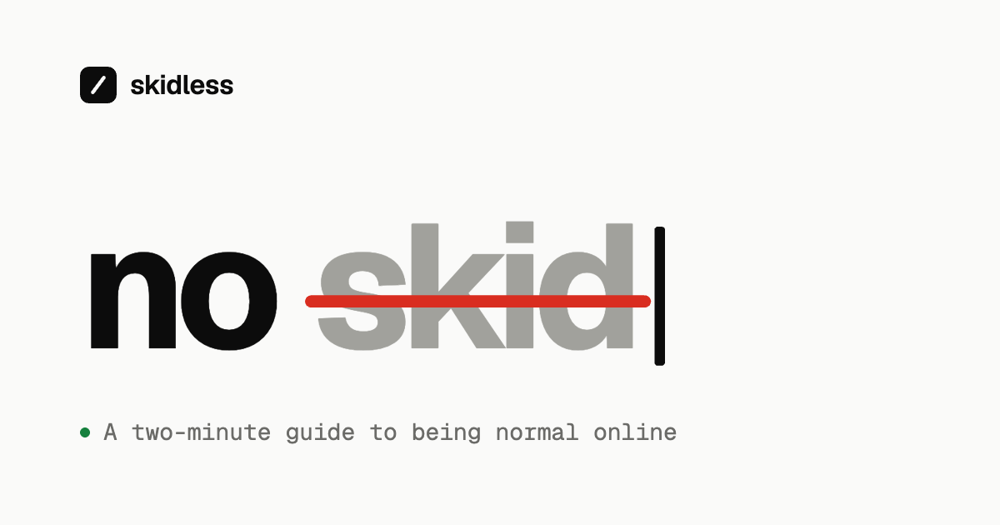

# skidless



A minimal, two-minute guide to being normal online.

Reading out someone's IP, faking a hack with Inspect Element or threatening a DDoS doesn't make you a hacker. **skidless** is a single page that shows what that looks like, and what works better.

## Features

- **One static page.** Plain HTML, CSS and a little JavaScript. No framework, no dependencies, no build step.
- **Private by default.** Fonts are self-hosted, so the page makes no third-party requests. No cookies, no analytics.
- **Light and dark.** Follows the system theme, with a toggle that remembers the visitor's choice.
- **Easy to share.** Opens the native share sheet on phones and copies the link on desktop. Includes a social preview image and a home-screen icon.
- **Accessible.** Semantic markup, a skip link, visible focus styles, and respect for reduced-motion settings.

## Project structure

```
.
├── index.html              Page markup and share-preview tags
├── assets/
│   ├── style.css           Styles; color tokens live at the top
│   ├── main.js             Theme toggle, "no ___" typewriter, share button
│   └── fonts/              Geist and Geist Mono (WOFF2) with their license
├── favicon.svg             Browser tab icon
├── apple-touch-icon.png    Home-screen icon (180 × 180)
└── og.png                  Social preview image (1200 × 630)
```

## Run locally

There is nothing to install. Serve the folder with any static file server:

```bash
python3 -m http.server 8000
```

Then open <http://localhost:8000>.

## Deploy

Any static host works. Point it at the repository root with no build command.

- **Cloudflare Pages:** create a project from this repository, choose *None* as the framework preset, leave the build command empty and set the output directory to `/`.
- **GitHub Pages:** go to *Settings → Pages*, choose *Deploy from a branch*, then select `main` and `/ (root)`.

The share-preview tags in `index.html` assume the site lives at `https://skidless.org/`. If you deploy to a different domain, update the `canonical`, `og:url` and `og:image` URLs.

## Customize

| What | Where |
| --- | --- |
| Page text and chat examples | `index.html` |
| Colors (each token is `light-dark(light, dark)`) | top of `assets/style.css` |
| Struck-through phrases in the title | `PHRASES` in `assets/main.js` |
| Typing speed and pauses | `TIMING` in `assets/main.js` |

## License

The code is released under the [MIT License](LICENSE).

The bundled fonts, [Geist and Geist Mono](https://github.com/vercel/geist-font), are © The Geist Project Authors and licensed under the [SIL Open Font License 1.1](assets/fonts/OFL.txt).
